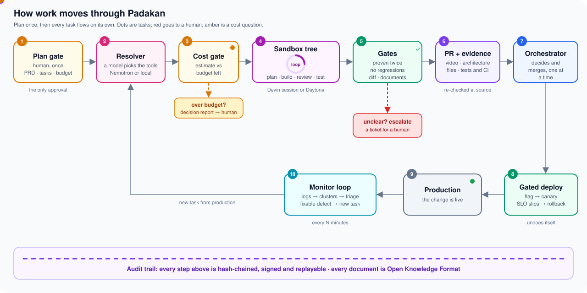

<div align="center">

# Padakan

**Autonomous development you can trust.**
A Claude Code plugin that lets coding agents plan, build, verify and ship on their own, and only lets a change reach production once the system has proven it safe.

**[inloop-nine.vercel.app](https://inloop-nine.vercel.app)** · the product page

[](https://docs.claude.com/en/docs/claude-code)
[](https://nodejs.org)
[](https://docs.tokenfactory.nebius.com)
[](https://nebius.com/services/token-factory/nemotron)
<br>
[](https://www.daytona.io)
[](https://docs.devin.ai)
[](#)
[](https://entire.io)
[](https://cloud.google.com/blog/products/data-analytics/how-the-open-knowledge-format-can-improve-data-sharing)
<br>
[](https://inloop-nine.vercel.app)
[](#status)
[](https://github.com/Rouxxel/Padakan/actions/workflows/test.yml)
[](package.json)
[](LICENSE)

</div>

## Why

Pointing a coding agent at a task and getting a plausible change is a solved problem. Shipping that change without a human reading it is not, so a human stays in the loop, the loop becomes the bottleneck, and the autonomy disappears. That is a trust problem, not a capability problem.

Padakan solves it with the system around the agent. The agent is a black box that can be swapped. What earns the trust is the set of checks, gates, evidence and records that every change passes through.

## What it does

| | |
|---|---|
| **One human gate, up front** | The human approves the PRD, the task plan, the budget and the brand once. A decision model, not the human, picks the tools each agent gets. After that nothing asks a question, unless a step would break the budget. |
| **The orchestrator only decides** | It decides, dispatches, merges, deploys and records. Sub-agents do all other work and return one line each, so the orchestrator stays fast over long runs. |
| **One sandbox per task** | Each agent works in its own Devin session (default) or Daytona sandbox, watched live in the Devin web app or in herdr. |
| **Proven, not claimed** | Every change is proven twice, by its tests and live against the running app. The full suite and the critical-flow e2e suite stay green, and deterministic diff inspection confirms the change stays within its limits and touches no protected path, secret or unapproved dependency. |
| **Evidence on every PR** | A video of the change working, the architecture of the change, the files touched and the CI results, each re-checked at its source. |
| **Safe to fail** | Gated deploy behind a flag and a canary, with automatic rollback when an SLO slips. |
| **Self-healing** | A monitor loop reads production logs, triages them with Nemotron on Nebius, and turns fixable defects into new tasks. |
| **Everything on the record** | A hash-chained audit trail and an Open Knowledge Format bundle of every brief, report and decision, kept next to the repo. |

## How it works

<p align="center">
  
</p>

Each dot is a task. It moves left to right through the top row, ships, and comes back as a new task when the monitor loop finds a defect in production. Red dots leave the line for a human (an unclear gate). Amber dots stop for a cost decision.

| # | Stage | What happens | Who decides | Built in |
|---|---|---|---|---|
| 1 | **Plan gate** | The human approves the PRD, the task plan with stories and acceptance criteria, the budget and `brand.md`. This is the only approval. | the human, once | `/padakan:plan`, `padakan gate` |
| 2 | **Resolver** | A decision model picks each task's target, platform, verify kit (MCP servers and CLIs), skills and cost range, only from the registry. | a model (Nemotron on Nebius, or a local model) | `core/resolver.mjs`, `padakan resolve` |
| 3 | **Cost gate** | The worst-case estimate is compared with the budget left. Within budget the step runs; over budget that tree pauses and a decision report goes to the human. | arithmetic, then the human only for money | `core/cost.mjs`, `/padakan:decide` |
| 4 | **Sandbox tree** | One sandbox per task (a Devin session or a Daytona sandbox). The builder plans, builds, reviews and tests in a loop, pushes, and opens a PR. Nobody answers its questions: it decides by rule or reports `BLOCKED`. | the agent, inside its sandbox | `sandboxes/`, `padakan plant`, `brief`, `poll` |
| 5 | **Gates** | Proven twice (the task's tests and every acceptance criterion live), no regressions (suite and critical-flow e2e), deterministic diff inspection, valid documents, a verified evidence pack. | code, never a model | `core/gates.mjs`, `core/diffcheck.mjs`, `core/okf.mjs` |
| 6 | **PR and evidence** | Video of the change working, architecture of the change, files touched (from git), tests and CI, each re-checked at its source. | the verifier | `core/report.mjs`, `padakan evidence`, `padakan verify` |
| 7 | **Orchestrator** | Merges a verified head, one change at a time. `HUMAN_MERGE` waits for a named approver; `ESCALATE` becomes a ticket. | the orchestrator | `padakan merge` |
| 8 | **Gated deploy** | Behind a flag, then a canary; when the SLO slips it rolls back by itself and escalates. | code | `core/deploy.mjs`, `padakan deploy` |
| 9 | **Production** | The change is live. | | |
| 10 | **Monitor loop** | Every few minutes: collect logs, cluster them by fingerprint, triage with a model, open a task for each fixable defect, send security and unknowns to a human. | a model, then rules | `core/collect-logs.mjs`, `core/triage.mjs`, `padakan tick` |

Underneath everything, every step is appended to a **hash-chained, signed audit trail** that a human can replay, and every document the agents write is an **Open Knowledge Format** document in a records folder next to the repository.

## Install

In Claude Code (2.1.275 or later):

```
/plugin install padakan --marketplace Rouxxel/Padakan
```

## Status

**In development.** The core is built and tested (zero dependencies, `npm test`); the build is tracked as [GitHub issues](https://github.com/Rouxxel/Padakan/issues), one per module.

| Area | State |
|---|---|
| Plugin scaffold, settings (`.env`), records folder, OKF validator | done |
| Audit trail, diff inspection, verification gates | done |
| Sandbox gateway and contract, `local` provider | done |
| Agents (14), skills (13), hooks (4), commands (11) | done |
| Lifecycle steps and `bin/padakan`, capability resolver, monitor loop | done |
| `daytona` provider (snapshot, seed, bootstrap, herdr attach) | done ([#46](https://github.com/Rouxxel/Padakan/issues/46)) |
| `devin` provider, cost gate and decision report | in progress ([#10](https://github.com/Rouxxel/Padakan/issues/10), [#6](https://github.com/Rouxxel/Padakan/issues/6)) |
| Evidence pack builder, gated deploy (simulated target), CI docs gate and e2e templates | done |

## Quick start

```bash
git clone https://github.com/Rouxxel/Padakan.git && cd Padakan
npm test                                   # Node 22+, no install step

# in the repository you want Padakan to work on:
/path/to/Padakan/bin/padakan init          # records folder next to the repo
/path/to/Padakan/bin/padakan doctor        # checks every setting and tool
```

Then, in Claude Code with the plugin installed: `/padakan:onboard`, `/padakan:plan <what to build>`, `/padakan:build <TASK>`. Every setting is documented in [`.env.example`](.env.example).

## Documentation

| You want | Read |
|---|---|
| The product page | [inloop-nine.vercel.app](https://inloop-nine.vercel.app) |
| A visual walkthrough | [documentation/tech_docs/blueprint.html](documentation/tech_docs/blueprint.html) (open in a browser) |
| The architecture | [documentation/tech_docs/ARCHITECTURE.md](documentation/tech_docs/ARCHITECTURE.md) |
| The pipeline, animated | [documentation/tech_docs/diagrams/pipeline-animated.svg](documentation/tech_docs/diagrams/pipeline-animated.svg) |
| The full system diagram | [documentation/tech_docs/diagrams/system-overview.svg](documentation/tech_docs/diagrams/system-overview.svg) |
| How to write a sandbox provider | [sandboxes/README.md](sandboxes/README.md) |
| The plugin's file structure and every `.env` setting | [documentation/tech_docs/PLUGIN-STRUCTURE.md](documentation/tech_docs/PLUGIN-STRUCTURE.md) |
| Every API, framework and tool used | [documentation/infrastructure/TOOLS.md](documentation/infrastructure/TOOLS.md) |
| Report and brand templates | [templates/](templates/) |

## Origin

Padakan started at the AI Hackathon with Nebius and NVIDIA in Berlin (October 2026).

## License

[Apache 2.0](LICENSE)
