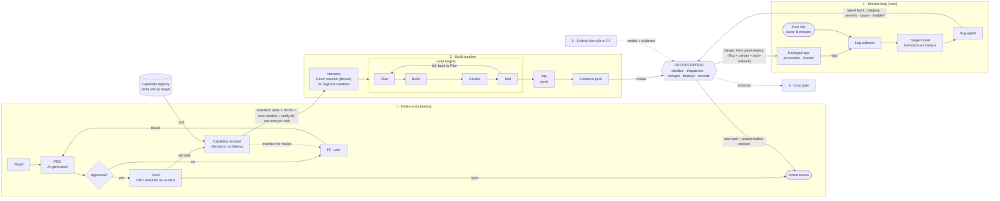
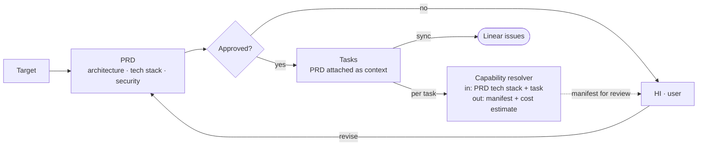
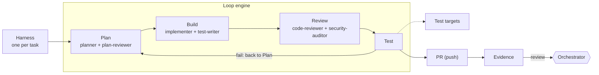
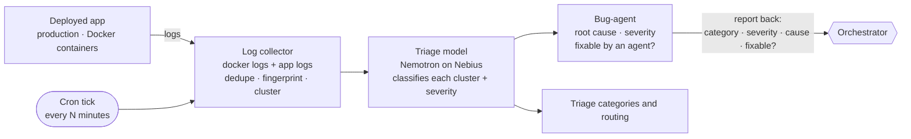
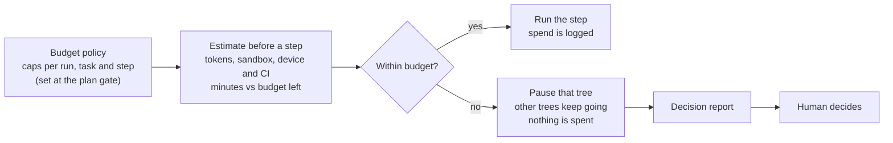
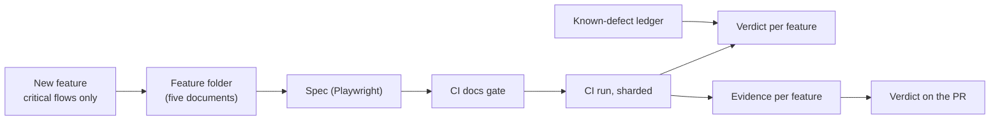

# Padakan: system overview

Markdown version of [system-overview.svg](./system-overview.svg). Prose and design rationale live in [ARCHITECTURE.md](../ARCHITECTURE.md).

> Plan once with a human gate, then everything runs headless: no agent ever asks a question. The only live question to a human is a cost question (lane 4). Records live next to the repo in `<repo>-padakan/`.

## The whole picture

## Lane 1 · Intake and planning

| Step | Detail |
|---|---|
| Target | What to build or change |
| PRD | AI-generated: architecture, tech stack, security |
| Approved? | No: goes to the human (HI), who revises the PRD. Yes: becomes tasks |
| Tasks | The PRD is attached as context to every task; synced to Linear issues |
| Capability resolver | Nemotron on Nebius, typed output. In: PRD tech stack + task. Out: manifest + cost estimate. Picks from the capability registry |
| brand.md + designer agent | Logo, palette, type, voice: written and approved at the plan gate. `ux-designer` and `design-implementer` build UI and reports with it |

**Plan gate (human in the loop).** The user and the orchestrator define the plan together:

1. approve the PRD (architecture, tech stack, security)
2. approve the task plan and its user stories
3. review each capability manifest: the tools every agent gets
4. set the budget: caps per run, task and step
5. approve the brand file (logo, palette, type, voice)

After this gate the human is asked again only if a step breaks the budget.

## Capability registry · verify kits by target

What the resolver chooses from.

| Target | MCP | CLI | Notes |
|---|---|---|---|
| **Web** | Playwright MCP (drive and assert in a browser), Chrome DevTools MCP (console, network, performance) | vitest / jest, lighthouse | Evidence: video, trace, logs |
| **iOS** | MobileBuildMCP (getsentry): build, run, test on simulator, UI automation, logs | xcodebuild, xcrun simctl | Needs a Mac runner (Xcode 16+) |
| **Android** | AndroidBuildMCP or adb-mcp: Gradle build, emulator, UI tree, logcat, screen recording | adb, gradle, emulator | Needs Android SDK + JDK 17 |
| **Backend / API** | none required | curl, docker logs, docker compose; pytest / jest | Logs also feed the monitor loop |
| **Always available** | Linear (issues) | | Skills: TDD, code review, security, debugging, docs. Local models: code, classifier, log triage. The resolver picks per task |

## Lane 2 · Build pipeline

| Stage | Detail |
|---|---|
| Harness | Devin session (default) or Daytona sandbox, one per task. Agents: Claude · Pi · Codex · OpenCode · Devin |
| Plan | planner + plan-reviewer; read code, saved plans |
| Build | implementer + test-writer; code style, semantics |
| Review | code-reviewer + security-auditor |
| Test | Fails loop back to Plan |
| PR | push |
| Evidence | Evidence pack built by the agent, attached to the PR |

**Test targets.** Web: Playwright MCP, Chrome DevTools MCP, unit tests. iOS: MobileBuildMCP on the simulator. Android: adb MCP on the emulator. **Proven twice:** test-runner suites, then live probes.

**Evidence pack, attached to the PR:**

1. Video of the change working (browser, simulator, emulator)
2. Architecture of the change: what changed and why
3. Files touched or edited: diff summary, paths, size
4. Tests and CI: generated, run, validated as pass

The orchestrator re-checks each item itself.

## Orchestrator (hub)

- Only decides, dispatches, merges, deploys, records.
- Delegates all other work to sub-agents; reads one result line per agent.
- **Decides on reports:** new task? spawn builder session? escalate to human? ignore?
- Owns the cron job and the records folder.
- Enforces the cost gate (lane 4).
- Merge, then gated deploy.

Outgoing arrows: **new task + spawn builder session** (to Linear issues and a new harness) and **merged change reaches production behind a flag and canary, with auto-rollback** (to the deployed app).

## Lane 3 · Monitor loop (cron)

**Triage categories and routing**

| Category | Examples | Route |
|---|---|---|
| Code defect | crash · wrong output · regression | becomes a task, may be automatic |
| Performance / SLO | latency · memory leak · timeouts | becomes a task, usually escalated |
| Infra / config | OOM · restart loop · bad env var | ops alert, human |
| Security | auth spikes · secret in logs | human at once, never auto |
| External dependency | third-party 5xx · DNS · quota | watch and retry, no change |
| Data issue | bad record · failed migration | human |
| Noise / expected | 4xx · health checks · known warnings | drop |
| Unknown / low confidence | cannot classify, conflicting signals | human (the default) |

## Lane 4 · Cost gate and decision report

The human decides when a step is too expensive.

**Never waived for cost:** the task's tests, the full regression suite, diff inspection. Cost can only affect optional heavy checks (device probes, video, browser matrix). If a required check is over budget, ask to raise it.

| Decision report | Human decides |
|---|---|
| What: the step, and the task it belongs to | approve: spend it |
| Why: the claim it proves, the risk it covers | cheaper: run the alternative |
| Cost: low / likely / high, and budget left | skip: not auto-shipped, goes to a human |
| Cheaper options, and what each leaves uncovered | raise the budget, or abort (escalate) |
| If skipped: what stays unverified | no answer: stays paused, nothing spent |
| **Recommendation** | report and answer go to the audit trail |

## Lane 5 · Critical-flow e2e suite in CI

Every new feature ships with stories, architecture, a playbook and a spec.

| Box | Content |
|---|---|
| New feature | Critical flows only: sign-in, dashboard, checkout, and so on |
| Feature folder | `feature.md` · `stories.md` (US1 to USn) · `workflow.md` (architecture, how to confirm) · `playbook.md` (steps and criteria AC1 to ACn) · `setup.md` (what it needs, what it costs) |
| Spec (Playwright) | One test per feature, one soft assertion per criterion, labeled ACn; judged on captured traffic and re-read state, not on the paint |
| CI docs gate | Fails the PR if a document is missing, a story has no criterion, a criterion has no assertion, or the spec does not typecheck |
| CI run, sharded | Twice per change: on the PR preview before the merge, on staging after it. Fresh identities minted every run, never production, no cached session |
| Verdict per feature | `PASS` · `KNOWN` · `FAIL` · `BROKEN` · `STOPPED` · `NOT RUN`. "Not exercised" is never a pass: a criterion the run never judged shows as not exercised, never as green. The roster of criteria comes from the playbook, not from what happened to run |
| Known-defect ledger | criterion + issue + reason + review date. A ledgered failure is KNOWN, not red; it starts passing: red, fix detected; unlisted failure: a regression; stale or overdue entry: red |
| Evidence per feature | `video/run.mp4` (merged, seekable), `trace.zip` and numbered screenshots, `report.html` (self-contained, one anchor per criterion, embeds its own video), `summary.md` for the PR comment |
| Verdict on the PR | Status, then summary, then the criterion, then its video. Read by the orchestrator: part of the gates and the evidence pack |
