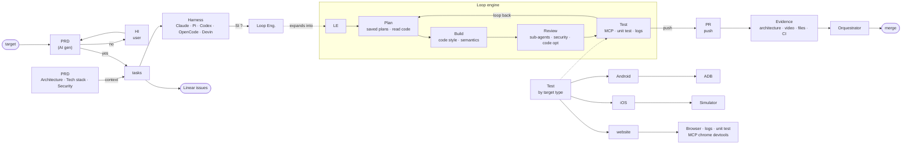

# Padakan: whiteboard, redrawn

Markdown version of [whiteboard.svg](./whiteboard.svg), which is itself redrawn from the photo [first-iteration.jpeg](./first-iteration.jpeg). The refined design is in [system-overview.md](./system-overview.md) and [ARCHITECTURE.md](../ARCHITECTURE.md).

## Elements

### Top row: intake

| Element | Notes |
|---|---|
| target | What to build |
| PRD | AI-generated |
| yes / no | Approved PRD goes to tasks; rejected goes to **HI** (the user), which loops back to the PRD |
| tasks | Create **Linear issues** |
| PRD (detail) | Architecture, tech stack, security; passed to tasks as **context** |
| Harness | Any agent: Claude, Pi, Codex, OpenCode, Devin |
| SI ? | Label on the arrow from Harness to the loop engine; hard to read on the photo |
| Loop Eng. | Expands in the bottom row |

### Middle: test by target type

| Target | Tools |
|---|---|
| website | Browser · logs · unit test · MCP Chrome DevTools |
| iOS | Simulator |
| Android | ADB |

The chooser feeds the **Test** step of the loop engine (dashed arrow).

### Bottom row: loop engine

| Step | Notes |
|---|---|
| LE | Entry point of the loop engine |
| Plan | saved plans, read code |
| Build | code style, semantics |
| Review | sub-agents, security, code opt |
| Test | MCP, unit test, logs; **loop back** to Plan on failure |

### Right: delivery

`Test` → **push** → `PR` → `Evidence` (architecture, video, files, CI) → `Orquestrator` → **merge**.

## Notes

- Redrawn from the whiteboard photo. The "SI ?" label and the Review list were hard to read.
- "Orquestrator" is spelled as on the whiteboard.
